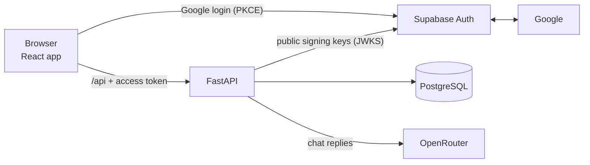
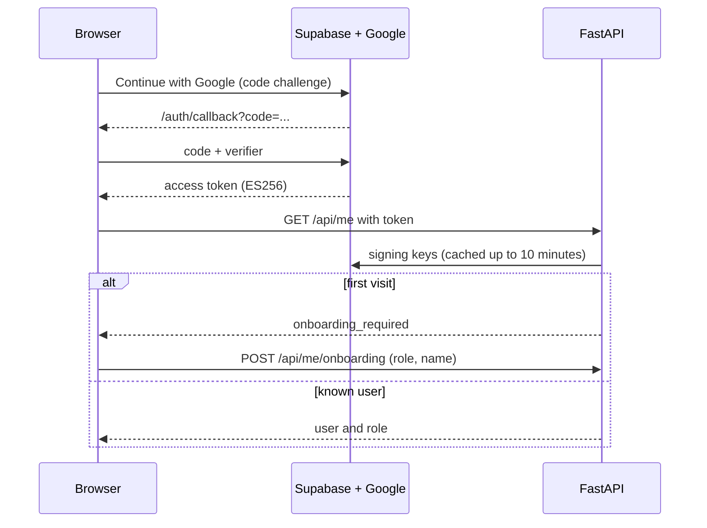
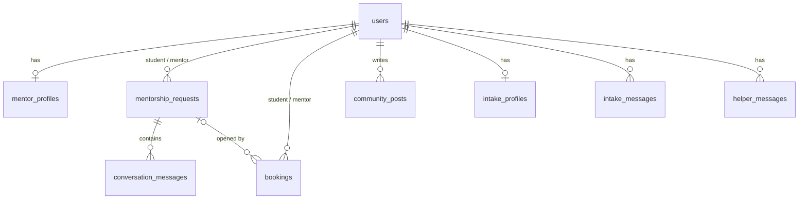
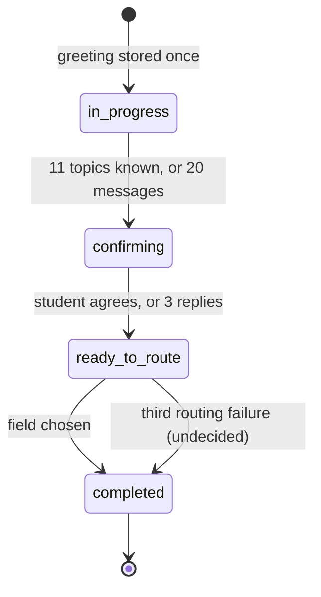
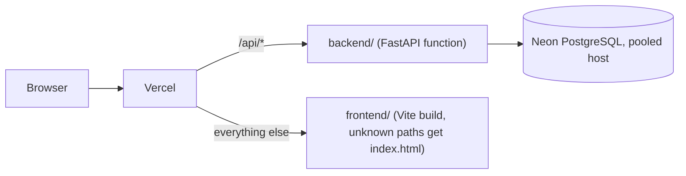

# Architecture

## Overview

Supabase only proves who someone is. All app data is in our PostgreSQL. The backend needs the Supabase project
URL and nothing secret from Supabase.

## Login

The token must have the right signature, issuer, audience `authenticated`, expiry and subject, and must not be an
anonymous user. If the keys cannot be loaded the API answers 503, so people are not logged out by an outage.
Unknown key ids trigger at most one key download per 10 seconds.

Demo login (`DEMO_LOGIN=true`, development only) uses separate tokens: HS256, our own secret, issuer `jugnu-demo`.
A demo token can only act as a seeded user, never as a Google account.

## Data

| Table | Rules enforced by the database |
|---|---|
| users | `auth_subject` unique (null only for seeded people); role is student or mentor |
| mentor_profiles | known field; rate ₹1 to ₹100,000 in whole rupees; `is_listed` defaults to false |
| mentorship_requests | one per student and mentor; accepted exactly when `accepted_at` is set |
| conversation_messages, community_posts | text not blank, at most 1500 characters |
| bookings | one per student and idempotency key; total = rate × minutes ÷ 60; confirmed exactly when a conversation exists |
| intake_profiles | one per student; known status and field; lease columns `busy_token`, `busy_until` |
| intake_messages, helper_messages | role is user or assistant |

## API (`/api`)

| Who | Endpoints |
|---|---|
| Anyone | `GET /health` `/config` `/mentors` `/mentors/{id}` `/community/{field}/posts`; `POST /auth/demo` (404 unless enabled) |
| Verified token | `GET /me`; `POST /me/onboarding` |
| Any account | `GET /dashboard` `/requests` `/bookings`; `POST /community/{field}/posts` |
| Student | `POST /mentors/{id}/requests` `/bookings` `/intake/start` `/intake/messages`; `GET` and `DELETE /intake`; `GET` and `POST /helper/messages` |
| Mentor | `PATCH /mentor/rate`; `POST /requests/{id}/accept` `/bookings/{id}/confirm`; `GET /requests/{id}/student-brief` |
| The two people in an accepted request | `GET` and `POST /requests/{id}/messages` |

## Intake chatbot

One student message runs: take the lease, store the message, ask the AI to extract facts, merge them, decide the
next state, ask the AI for a reply, store it, release the lease.

- **Lease:** one conditional `UPDATE` claims the chat for 120 seconds. A second message meanwhile gets 409. A crash
  cannot block a student for longer than that. Known limit: an AI call that outlives the lease could overlap with
  the next turn.
- **No connection is held during AI calls.** Each store method is its own short transaction.
- **Failed replies** are not stored. Sending the same text again does not store a copy or use up a turn.
- **Privacy:** students and the helper bot never receive the follow-up flag, mentor focus or reasoning. A connected
  mentor sees a short brief, without age, location or constraints. The follow-up flag is set by AI and can miss
  students: it is not a safety system.

`AI_MODE=demo` swaps in `ScriptedLLM`, which fills topics in order using no AI.

## Decisions

| Decision | Why |
|---|---|
| Synchronous SQLAlchemy | Simple, and async psycopg conflicts with the default Windows event loop |
| Own users table beside Supabase | Roles and data stay ours; changing the login provider touches one file |
| Text + CHECK instead of PostgreSQL enums | Easier to change in a migration |
| Whole-rupee rates | Every allowed session length gives an exact price, so nothing is rounded |
| Idempotency key checked before rate | A retry after a lost response must succeed even if the rate changed |
| Polling (3 s chat, 10 s pages) | Enough for a demo; no WebSocket infrastructure |
| Public settings from `/api/config` | One built frontend works in every environment |
| New mentors hidden until approved | Students may be minors |
| Fields without mentors are said openly | The prototype silently sent them to Civil Services |

## Hosting on Vercel

`vercel.json` makes one Vercel project with two services on one address:

- The backend receives the full path (`/api/health`), so routes keep their `/api` prefix. Any new endpoint must stay
  under `/api`, or the frontend service will answer it.
- Same address for both, so no CORS and no API address setting; `/api/config` still provides the public settings.
- Why not Netlify: its proxy stops after 26 seconds, and a guide turn can take about 75 seconds (three 25-second AI
  calls). A Vercel Python function may run 300 seconds on the Hobby plan.
- Each running copy of the function has its own small connection pool, so the app connects through Neon's pooler.
  Poolers in transaction mode break psycopg's server-side prepared statements, so `db.py` sets
  `prepare_threshold=None`. Hosted databases need TLS: `DB_SSLMODE=require`.
- Migrations and seeding run from a developer machine against Neon, never during a deploy.
- Every poll (3 s in a chat, 10 s on pages) is a function call and counts toward the plan's usage.
- `.vercelignore` keeps `.env`, `.venv`, tests and `resources/` out of uploads made with the Vercel CLI.
- Vercel Services is in Beta. If its routing changes, the fallback is two Vercel projects, with the frontend
  forwarding `/api` to the backend project.

## Dockerizing later

Already in place: all settings from environment variables, stateless API, logs to stdout, health endpoint, pinned
dependencies, relative `/api` calls, migrations separate from startup.

Still to do:
1. `backend/Dockerfile`: Python 3.12 slim, install `requirements.txt`, run
   `uvicorn app.main:app --host 0.0.0.0 --port 8000`.
2. `frontend/Dockerfile`: `npm ci && npm run build`, then serve `dist/` with nginx. nginx must send unknown paths to
   `index.html` and forward `/api` to the backend, with a read timeout above 90 seconds (a chat turn can make three
   25-second AI calls).
3. `docker-compose.yml`: PostgreSQL with a volume and health check, a one-off `alembic upgrade head` job, the API,
   the web server.
4. `.dockerignore`: `.venv`, `node_modules`, `dist`, `.env`, `resources`.
5. Add the deployed address to Google and Supabase (origin and `/auth/callback`). Keep `DEMO_LOGIN=false`.
